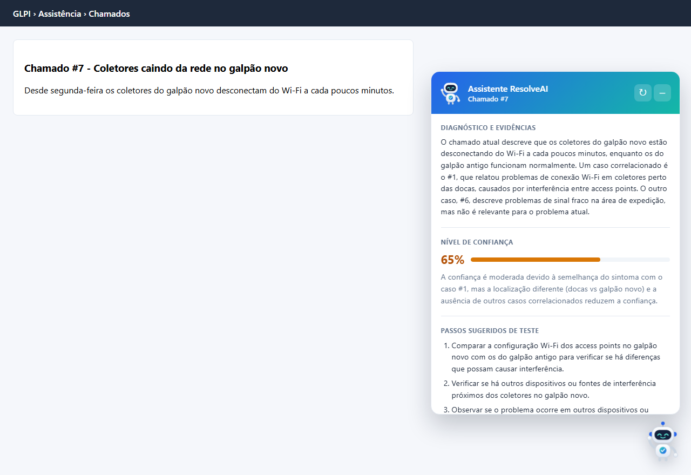
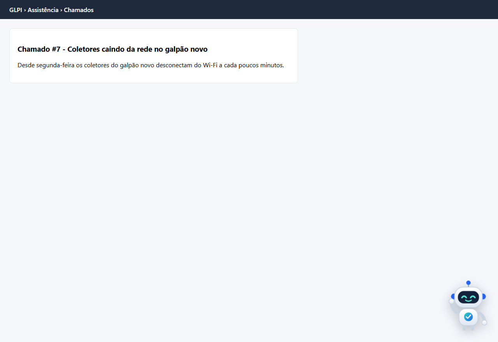
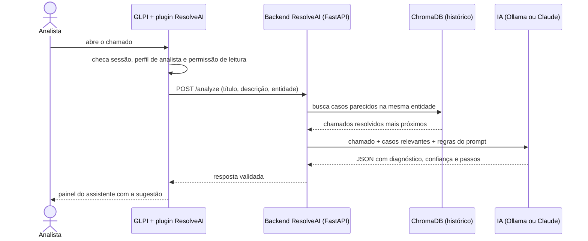
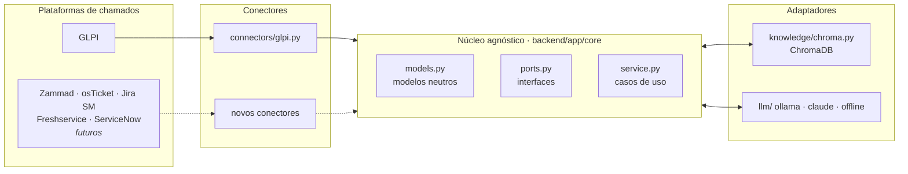

# 🤖 ResolveAI

**IA generativa a serviço do suporte de TI.** O ResolveAI lê o chamado que o analista acabou de abrir, encontra chamados parecidos que já foram resolvidos e sugere um diagnóstico, um nível de confiança e passos de teste, direto na tela do GLPI.



<sub>Análise real gerada pelo modelo gratuito `qwen2.5:7b` (Ollama) para o chamado de teste #7, a partir do histórico de exemplo em [`glpi/samples/chamados_teste.sql`](glpi/samples/chamados_teste.sql). O print foi feito numa página de pré-visualização com o mesmo CSS e JavaScript do plugin.</sub>

---

## 💡 O problema e a proposta

Equipes de suporte lidam todo dia com chamados repetitivos, consultas a documentações e históricos de incidentes. Muitas vezes a solução já existe, registrada em um chamado antigo, mas encontrá-la exige tempo que poderia ir para problemas mais complexos.

O ResolveAI usa **RAG (Retrieval-Augmented Generation)** para transformar esse histórico em ajuda prática:

1. **Lembra o que já foi resolvido.** Os chamados solucionados viram uma base de conhecimento pesquisável por significado, não só por palavra-chave.
2. **Contextualiza a IA.** Na análise, a IA recebe o chamado atual e os casos mais parecidos, e é instruída a se basear apenas neles.
3. **Sugere, não decide.** O resultado é uma sugestão para o analista validar. O ResolveAI não altera, responde nem fecha chamados.

> **Status:** projeto em desenvolvimento ativo. A leitura do histórico do GLPI, a busca de casos parecidos, a análise com IA e o assistente no GLPI já funcionam.

---

## ✨ Funcionalidades

- **Assistente flutuante no GLPI.** Um robô fica no canto da tela e se expande sozinho quando o analista abre um chamado. Ele mostra:
  - o diagnóstico, com as evidências;
  - a confiança, numa barra colorida;
  - os passos de teste sugeridos.
- **Busca semântica no histórico.** Os chamados solucionados ou fechados, com suas soluções e acompanhamentos, são indexados no **ChromaDB** de forma incremental.
- **IA gratuita por padrão.** Roda localmente com **Ollama**, e os dados dos chamados não saem da sua rede. Quem preferir pode usar o **Claude** (Anthropic, pago) mudando uma variável.
- **Resposta sempre no mesmo formato.** A saída da IA é JSON validado contra um schema, e o plugin só exibe respostas que seguem esse contrato.
- **Isolamento por entidade.** A busca de casos parecidos nunca sai da entidade do chamado analisado, o que importa em ambientes com vários clientes.
- **Só para analistas.** Usuários da interface simplificada, os que abrem chamados, não veem o assistente.
- **Cache de análises.** Reabrir um chamado sem alterações mostra o resultado na hora.
- **Arquitetura agnóstica.** O núcleo não conhece o GLPI; outras ferramentas de chamados entram como novos conectores.

| Minimizado (qualquer página) | Expandido (ao abrir um chamado) |
|---|---|
|  |  |

---

## ⚙️ Como funciona



Em paralelo, o indexador (`python -m app.index`) lê periodicamente o banco do GLPI, numa conta somente leitura, e envia para o ChromaDB os chamados solucionados que foram alterados desde a última execução.

---

## 🧩 Arquitetura agnóstica

O diferencial do ResolveAI é um **núcleo de inteligência independente da ferramenta de chamados**. O GLPI é a primeira integração, mas o núcleo só conhece modelos neutros. Para integrar outra plataforma, basta escrever um conector.



| Camada | Responsabilidade |
|---|---|
| `core/models.py` | Modelos neutros: `Ticket`, `ResolvedTicket`, `SimilarCase` e `AnalysisResult` (o contrato de resposta). |
| `core/ports.py` | Interfaces `TicketSource` (origem dos chamados), `KnowledgeBase` (RAG) e `Analyzer` (IA). |
| `core/service.py` | Casos de uso: analisar um chamado e indexar o histórico de forma incremental. |
| `connectors/glpi.py` | O único módulo que conhece as tabelas do GLPI. Lê soluções e acompanhamentos e limpa HTML e assinaturas de e-mail. |
| `knowledge/chroma.py` | Base vetorial no ChromaDB, sempre filtrada por `tenant_id`. |
| `llm/` | Analisadores substituíveis: `ollama.py` (gratuito), `claude.py` (pago) e `offline.py` (sem IA). |
| `main.py` | API HTTP (`/health`, `/analyze`), autenticação por token e cache de análises. |

---

## 🧠 Escolha da IA

A IA é escolhida pela variável `RESOLVEAI_LLM` no `.env`:

| `RESOLVEAI_LLM` | Custo | Onde roda | Quando usar |
|---|---|---|---|
| `ollama` (padrão) | Gratuito | Na sua máquina ou servidor | Os chamados não saem da rede. Sem GPU, cada análise leva de 1 a 2 minutos; com GPU, segundos. |
| `claude` | Pago por uso | API da Anthropic | Melhor qualidade e respostas rápidas. Exige `ANTHROPIC_API_KEY` ([console.anthropic.com](https://console.anthropic.com)). |
| `offline` | Gratuito | Nenhuma IA | Só lista os chamados parecidos. Útil para testar a integração sem IA. |

O modelo padrão do Ollama é o `qwen2.5:7b`, que vai bem em português e em respostas estruturadas. Em máquinas modestas, o `qwen2.5:3b` (`OLLAMA_MODEL=qwen2.5:3b`) responde mais rápido.

---

## 🚀 Início rápido com Docker

Pré-requisitos: [Docker Desktop](https://www.docker.com/products/docker-desktop/) (ou Docker + Docker Compose) e cerca de 8 GB livres em disco para as imagens e o modelo de IA.

### 1. Clonar e configurar

```bash
git clone https://github.com/IngridSolAn/ResolveAi.git
cd ResolveAi
cp .env.example .env
```

O `.env` já vem com a IA gratuita (`RESOLVEAI_LLM=ollama`). Recomenda-se definir também um `RESOLVEAI_API_TOKEN`, um segredo compartilhado entre o plugin e o backend.

> ⚠️ As senhas do banco no `docker-compose.yml` são exemplos para uso local. Troque-as antes de usar em qualquer outro ambiente.

### 2. Subir os serviços

```bash
docker compose up --build -d

# Só na primeira vez: baixa o modelo de IA gratuito (~4,7 GB)
docker compose exec ollama ollama pull qwen2.5:7b
```

| Serviço | Endereço |
|---|---|
| GLPI | http://localhost:1201 |
| Backend (docs interativas) | http://localhost:8002/docs |
| ChromaDB | http://localhost:8001 |
| Ollama | http://localhost:11434 |

### 3. Instalar o GLPI e ativar o plugin

1. Acesse http://localhost:1201 e siga o assistente de instalação do GLPI. Na etapa do banco de dados, use:
   - **servidor:** `db`;
   - **usuário e senha:** os definidos em `docker-compose.yml`.
2. Entre no GLPI. O usuário padrão é `glpi` com senha `glpi`; troque essa senha.
3. Em **Configurar → Plugins**, instale e ative o **ResolveAI**. Se preferir, faça isso pelo terminal:

   ```bash
   docker compose exec -u www-data glpi php /var/www/html/glpi/bin/console plugin:install resolveai --username=glpi -n
   docker compose exec -u www-data glpi php /var/www/html/glpi/bin/console plugin:activate resolveai -n
   ```

### 4. (Opcional) Carregar chamados de exemplo

Para testar sem dados reais, carregue 6 chamados já resolvidos (Wi-Fi, impressora, ERP, VPN, Outlook) e 1 chamado aberto:

```bash
docker compose exec -T db mariadb -u<usuario> -p<senha> glpi < glpi/samples/chamados_teste.sql
```

### 5. Indexar o histórico

```bash
docker compose exec -e GLPI_READONLY_DATABASE_URL="mysql+pymysql://<usuario>:<senha>@db:3306/glpi?charset=utf8mb4" \
  backend-ai python -m app.index
```

A primeira execução indexa todo o histórico e também baixa o modelo de embeddings do ChromaDB (~80 MB, uma única vez). As execuções seguintes são incrementais; agende o comando (cron, agendador de tarefas) para manter a base atualizada.

> Em produção, use um usuário MySQL **somente leitura**, de preferência numa réplica do banco do GLPI.

### 6. Testar

Abra um chamado no GLPI (no exemplo, o chamado aberto *"Coletores caindo da rede no galpão novo"*). O robô do ResolveAI se expande e, depois da análise, mostra a sugestão. Se o navegador estiver com arquivos antigos em cache, recarregue com **Ctrl+F5**.

---

## 🛠️ Desenvolvimento local (sem Docker)

```bash
python -m venv .venv
source .venv/bin/activate        # Linux/macOS
# .venv\Scripts\activate         # Windows

cd backend
pip install -r requirements-dev.txt
uvicorn app.main:app --reload --env-file ../.env   # http://localhost:8000/docs
python -m app.index                                # lê o ../.env automaticamente
```

Para rodar fora do Docker, aponte `OLLAMA_HOST=http://localhost:11434` (com o Ollama instalado) e `CHROMADB_HOST` para um servidor Chroma. Se `CHROMADB_HOST` ficar vazio, o Chroma usa um diretório local em `CHROMA_PATH`.

Exemplo de chamada direta à API:

```bash
curl -X POST http://localhost:8000/analyze \
  -H "Content-Type: application/json" \
  -d '{"ticket_id": 7, "title": "Coletores caindo da rede", "description": "Desconectam do Wi-Fi a cada poucos minutos", "tenant_id": 0}'
```

### Protótipo em Streamlit

A raiz do projeto também tem um protótipo local, que importa um CSV de chamados e faz busca por palavras-chave:

```bash
pip install -r requirements.txt
streamlit run app.py
```

---

## 🔧 Configuração

Todas as opções estão comentadas no [`.env.example`](.env.example). As principais:

| Variável | Padrão | Descrição |
|---|---|---|
| `RESOLVEAI_LLM` | `ollama` | IA usada: `ollama`, `claude` ou `offline`. |
| `OLLAMA_MODEL` | `qwen2.5:7b` | Modelo do Ollama. |
| `OLLAMA_TIMEOUT_SECONDS` | `300` | Tempo máximo de uma análise no Ollama. |
| `ANTHROPIC_API_KEY` | — | Chave da Anthropic (só para `claude`). |
| `CLAUDE_MODEL` / `CLAUDE_EFFORT` | `claude-opus-5-5` / `medium` | Modelo e nível de esforço do Claude. |
| `RESOLVEAI_API_TOKEN` | — | Se definido, o backend exige `Authorization: Bearer <token>`. O plugin envia o mesmo valor. |
| `RESOLVEAI_API_TIMEOUT` | `300` | Quanto tempo o plugin espera pela análise. |
| `RAG_LIMIT` | `5` | Quantos casos parecidos buscar. |
| `RAG_MAX_DISTANCE` | `0.5` | Distância máxima (cosseno) para um caso ser enviado à IA. Casos pouco parecidos confundem modelos menores. |
| `ANALYSIS_CACHE_TTL_SECONDS` | `86400` | Por quanto tempo uma análise é reaproveitada (`0` desativa o cache). |
| `GLPI_READONLY_DATABASE_URL` | — | Conexão (somente leitura) usada pelo indexador. |

---

## 🔒 Segurança e privacidade

- **Segredos fora do código.** O `.env` é ignorado pelo git; use o `.env.example` como modelo.
- **Proxy no servidor.** O navegador nunca fala com o backend: o plugin PHP valida a sessão, o perfil de analista e a permissão de leitura do chamado, e só então chama a API.
- **Isolamento por entidade.** O `entities_id` do chamado é enviado como `tenant_id`, e a busca vetorial sempre filtra por ele.
- **Conteúdo não confiável.** O prompt trata o texto dos chamados como dado, não como instrução, o que reduz o risco de prompt injection. O plugin insere o conteúdo na página apenas como texto.
- **Com o Ollama, nada sai da rede.** Com o Claude, o conteúdo do chamado e dos casos parecidos é enviado à API da Anthropic.

---

## 🧪 Testes

```bash
cd backend && pytest     # núcleo, conector GLPI, IA, cache e API
pytest tests/            # protótipo Streamlit (a partir da raiz)
```

Os testes não chamam nenhuma IA real nem precisam de GLPI, ChromaDB ou Ollama rodando: usam implementações falsas das interfaces e respostas HTTP simuladas.

---

## 📁 Estrutura do repositório

```text
├── backend/                  # Núcleo de inteligência e API (FastAPI)
│   ├── app/core/             #   núcleo agnóstico: modelos, interfaces, casos de uso, cache
│   ├── app/connectors/       #   conectores por plataforma (GLPI)
│   ├── app/knowledge/        #   base vetorial (ChromaDB)
│   ├── app/llm/              #   IA: Ollama, Claude e modo sem IA
│   ├── app/prompts.py        #   prompt do sistema e schema da resposta
│   ├── app/main.py           #   endpoints /health e /analyze
│   ├── app/index.py          #   indexação incremental do histórico
│   └── tests/
├── glpi/
│   ├── plugins/resolveai/    # Plugin GLPI: assistente flutuante + proxy PHP
│   └── samples/              # Chamados de exemplo para demonstração
├── docs/img/                 # Imagens deste README
├── src/ + app.py + tests/    # Protótipo local em Streamlit
├── docker-compose.yml        # GLPI + MariaDB + backend + ChromaDB + Ollama
└── .env.example              # Modelo de configuração
```

---

## 🗺️ Limitações conhecidas e próximos passos

- **Embeddings em inglês.** A busca usa o modelo padrão do ChromaDB (all-MiniLM), treinado principalmente em inglês. Trocar por um modelo multilíngue deve melhorar a busca em português.
- **Velocidade sem GPU.** O Ollama só no processador leva de 1 a 2 minutos por análise; o cache ameniza isso em chamados reabertos.
- **Leitura via banco.** O conector GLPI lê o banco direto (réplica somente leitura). Um conector pela API REST oficial do GLPI está planejado.
- **Cache em memória.** O cache se perde quando o backend reinicia.
- **Próximas integrações:** Zammad, osTicket, Jira Service Management, Freshservice e ServiceNow, como novos `TicketSource`.
- **Mais conhecimento.** Indexar também artigos da base de conhecimento do GLPI e documentações técnicas.

---

## 🛠️ Tecnologias

- **Backend:** Python, FastAPI e Pydantic
- **IA generativa:** Ollama (modelos abertos, gratuito) ou Claude (API da Anthropic), com saída estruturada em JSON
- **RAG:** ChromaDB
- **Integração:** plugin GLPI (PHP + JavaScript) e SQLAlchemy/PyMySQL para ler o histórico
- **Infraestrutura:** Docker e Docker Compose
- **Protótipo:** Streamlit e pandas

---

## ✒️ Autora

**Ingrid Sol An**, idealização e desenvolvimento ([@IngridSolAn](https://github.com/IngridSolAn)).

> *"O futuro do suporte não está apenas em responder chamados mais rapidamente, mas em transformar conhecimento técnico em soluções acessíveis, consistentes e escaláveis."*
